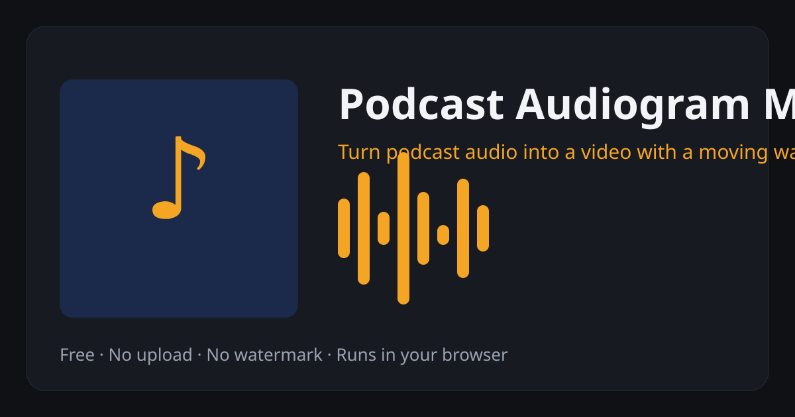
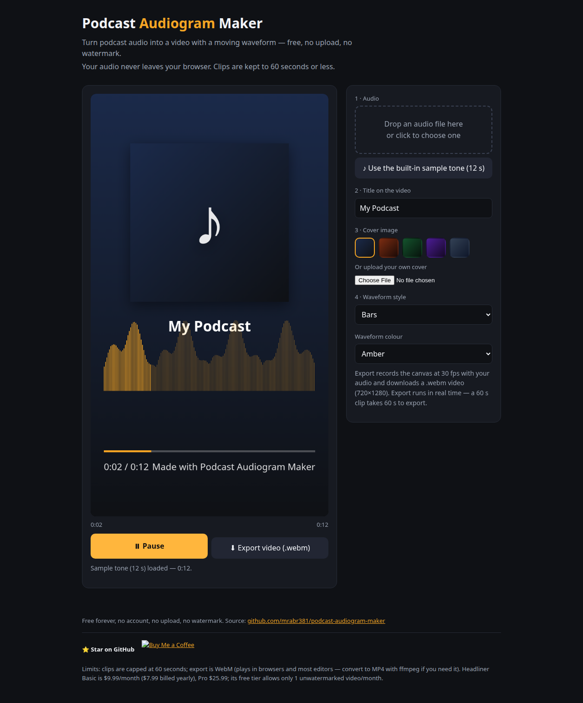
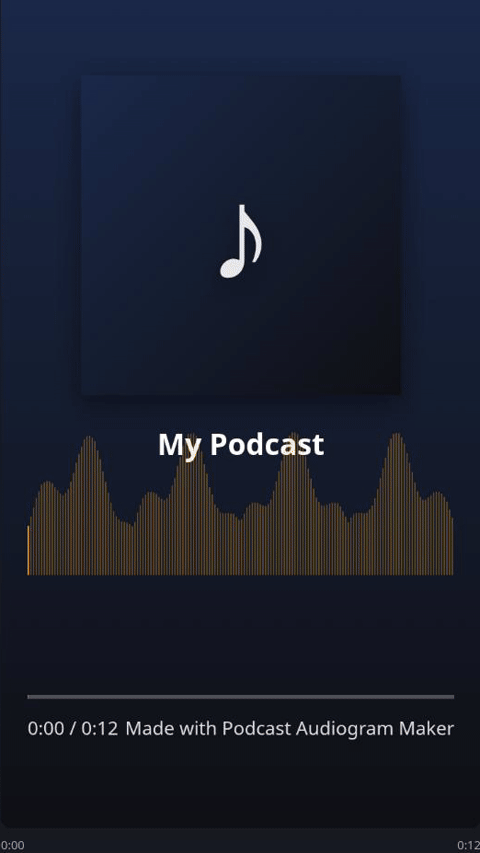

[](https://github.com/mrabr381/podcast-audiogram-maker)
[](https://www.buymeacoffee.com/muhammadabubakar)

# Podcast Audiogram Maker

**Turn podcast audio into a video with a moving waveform — free, no upload, no watermark.**

**Live demo:** https://mrabr381.github.io/podcast-audiogram-maker/



*The tool in action: the built-in sample tone playing, waveform animating on the canvas with a moving playhead and progress bar (0:02 / 0:12).*



## Why this exists

Paid tools charge for this. Headliner Basic is $9.99/month ($7.99 billed yearly),
Pro is $25.99 — and its free tier allows only 1 unwatermarked video/month.
This tool does the same core job in your browser, for free, with no account.

## How to use

1. Open the [live demo](https://mrabr381.github.io/podcast-audiogram-maker/)
   (or open `index.html` locally — no server, no build step, no keys).
2. Drop an audio file (MP3, WAV, OGG) — or click
   **"Use the built-in sample tone"** to try it with no file at all.
3. Pick a cover: upload your own image, or choose a built-in gradient cover.
4. Pick a waveform style and colour, and set the title shown on the video.
5. Press **Play** to preview the animated waveform, then **Export video (.webm)**
   to download a 720×1280 vertical video.

## What it does

- Draws your audio as an animated waveform on a canvas, with a moving playhead
  and progress bar, over your cover art and episode title.
- Exports with `MediaRecorder` (canvas video + your audio) as a `.webm` file.
- The sample tone is generated in code with the Web Audio API — there is no
  audio file in this repo.
- Nothing is uploaded. Your audio and cover never leave your browser.

## Honest limits

- **Clips are capped at 60 seconds.** Longer audio is trimmed to the first
  60 seconds. Long audio is slow to decode and record in a browser tab.
- **Export is WebM**, not MP4. It plays in browsers and most editors; convert
  to MP4 with `ffmpeg -i audiogram-....webm -c:v libx264 out.mp4` if you need it.
- **Export runs in real time** — a 60-second clip takes 60 seconds to export.
- Works best in Chrome or Firefox (needs `MediaRecorder` + `canvas.captureStream`).
- The waveform is computed from your audio's peaks — it is a visualisation,
  not a frequency spectrum.

## Run the tests

```bash
node --test "test/*.test.js"
```

Tests cover the core logic in `waveform.js`: waveform bar computation from
sample data, time formatting, clip-length capping, export filenames, and
playhead progress. CI runs them on every push (`.github/workflows/ci.yml`).

## Files

- `index.html` — the whole tool (HTML + CSS + JS, no dependencies)
- `waveform.js` — the pure logic, shared by the page and the tests
- `test/waveform.test.js` — Node test suite
- `assets/hero.svg` — README banner
- `assets/screenshot.png` — screenshot of the tool playing the sample tone
- `assets/demo.gif` — short animated demo of the playing waveform

## License

MIT. Free to use, copy, and modify.
